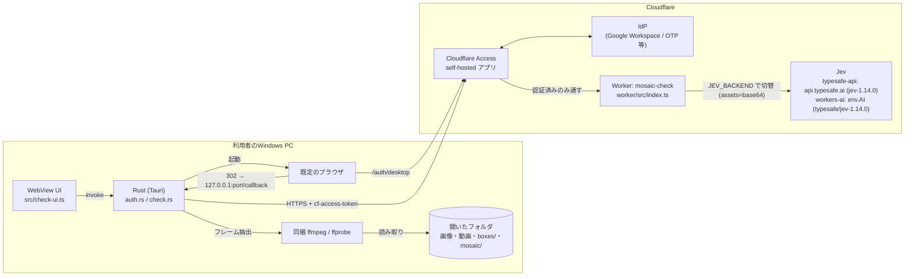
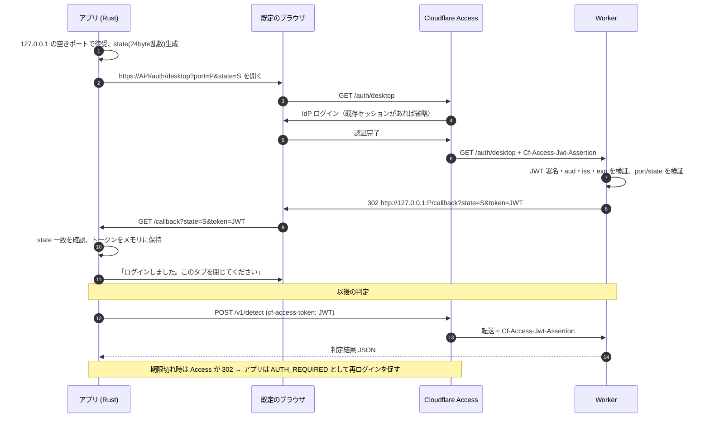

# 局部モザイク確認（AI判定）設計書

Mosaic Box Editor（Tauri デスクトップアプリ）に、Cloudflare Access でのログインと、
Jev モデルによるモザイク漏れ判定（ヘッダーの「**局部モザイク確認**」ボタン）を追加する設計です。
Jev の呼び出し先は Worker の環境変数 `JEV_BACKEND` で切り替えます（既定は TypeSafe の API を直接呼ぶ `typesafe-api`。
チームの許可が出たら `workers-ai` に切り替えられます。[api.md](api.md) 参照）。

| 文書                             | 内容                                       |
| -------------------------------- | ------------------------------------------ |
| この文書                         | 構成図、認証フロー、判定仕様、方式選定理由 |
| [api.md](api.md)                 | Worker API 仕様                            |
| [deploy.md](deploy.md)           | デプロイ手順書（実行は承認後）             |
| [estimate.md](estimate.md)       | 無料枠で1日に判定できる枚数の見積もり      |
| [open-issues.md](open-issues.md) | 未決事項                                   |

## 構成図

- 画像・フレームは Rust 側で JPEG（長辺 1024px 以下）に変換し、base64 で Worker に送ります。
  Worker は保存せず、Workers AI へそのまま渡します。
- Access のトークンは Rust プロセスのメモリだけに保持し、WebView（JS）には渡しません。
  JS が受け取るのはメールアドレスと有効期限だけです。
- TypeSafe の API キーは Worker のシークレット `TYPESAFE_API_KEY` にだけ置きます。アプリ・リポジトリ・ログ・レスポンスには出ません。
- Worker は Cron Trigger を持ちません（`wrangler.toml` に `[triggers]` なし）。
- Worker は Access 経由でしか到達できないよう `workers_dev = false` / `preview_urls = false` とし、
  さらに Worker 自身も `Cf-Access-Jwt-Assertion` を検証します（多層防御）。

## 認証フロー

### 方式の比較と選定理由

| 方式                                                       | 評価 | 理由                                                                                                                                                                                                                                   |
| ---------------------------------------------------------- | ---- | -------------------------------------------------------------------------------------------------------------------------------------------------------------------------------------------------------------------------------------- |
| **A. 既定ブラウザ + ループバック受け取り（採用）**         | ◎    | RFC 8252（ネイティブアプリの OAuth）推奨の「外部ユーザーエージェント」方式。ブラウザの既存 IdP セッション・パスワードマネージャー・パスキーがそのまま使える。追加の実行ファイル不要。Worker の小さな受け渡しエンドポイントだけで済む。 |
| B. アプリ内 WebView でログインし Cookie を読む             | △    | Google などの IdP は埋め込み WebView でのログインを拒否することがある（`disallowed_useragent`）。HttpOnly の `CF_Authorization` Cookie 取得に Tauri の Cookie API が必要で、バージョン依存が強い。                                     |
| C. `cloudflared access login` を同梱して呼ぶ               | △    | 公式手順で確実だが、約 50MB の実行ファイル追加と配布ライセンス管理が必要。トークン受け渡しの内部仕様は非公開。                                                                                                                         |
| D. サービストークン（Client ID / Secret）を exe に埋め込む | ✕    | 利用者ごとの識別ができず、秘密情報を配布物に含めることになる。                                                                                                                                                                         |
| E. Access Managed OAuth（2026-03 提供開始）                | ○    | 認可コードフロー + 127.0.0.1 リダイレクトに対応した正攻法。ただし RFC 8707 対応のクライアント実装・動的クライアント登録が必要で、PKCE の扱いがドキュメントで未確認。将来の移行先候補（[未決事項](open-issues.md)）。                   |

採用方式 A の注意点と対策:

- トークンが URL クエリでループバックに渡るため、ブラウザ履歴に残ります。宛先は `127.0.0.1` のみで
  外部へは送られませんが、Access のアプリケーションセッション時間を短め（例: 8〜24時間）にして影響を抑えます。
- `/auth/desktop` は `port`（1024〜65535）と `state`（16〜128文字の URL-safe 文字）を検証し、
  リダイレクト先は `http://127.0.0.1:<port>/callback` に固定です（オープンリダイレクトにしない）。
- アプリは `state` 不一致の応答を拒否し、5分でタイムアウトします。
- トークンは判定 API の URL（ログイン時に指定したオリジン）にのみ送信します。HTTPS 以外は
  `localhost` / `127.0.0.1`（`wrangler dev` 用）だけ許可します。

## 判定仕様

既存の `mosaic_check.py` の基準を踏襲します（同スクリプトはリポジトリ内・作業環境内に見つからなかったため、
依頼文の基準を仕様として実装しています。[未決事項](open-issues.md) 参照）。

- **動画**: ffprobe で長さを取得し、均等に分けた 10 区間の中央時刻（`(i + 0.5) × 長さ / 10`）から
  1 フレームずつ、計 10 フレームを抽出します。
- **画像**: 1 枚を判定します（JPG / PNG / WebP / BMP）。
- **判定のしきい値**（`ng_check.py` と同じ）: 検出の確率が **0.8 以上で NG**、**0.5〜0.8 は要確認**、0.5 未満は検出なし。
  ファイルは、NG の検出が 1 つでもあれば NG。次に、判定できなかったフレームがあれば **エラー**（OK とは扱わない）。
  それ以外で 0.5〜0.8 の検出があれば **要確認**、無ければ OK。
  Worker は 0.5 以上（`JEV_THRESHOLD`）の検出だけを返し、0.8 の線引きはアプリ側（`NG_SCORE`）で行います。
- 対象は「元の画像・動画」（開いたフォルダ、`boxes/` `mosaic/` を除く）か「書き出し済み（`mosaic/`）」を選べます。
  書き出し済みの判定が、納品物の最終チェックに相当します。
- 1 リクエスト 1 フレームで送信します（Workers Free の CPU 制限対策、失敗フレームの個別記録）。Worker への同時リクエストは **アプリ全体で最大 20**（Rust 側の共有上限。ファイル 4 本を同時に処理し、各ファイルの 10 フレームも並列）、FFmpeg のフレーム抽出は同時 6 本までです。429 / 529 / 502〜504・接続エラー（Worker が 200 で返す `model error (TypeSafe API HTTP 429)` を含む）は、Retry-After または 1・2・4 秒の待ちで最大 3 回再送し、401 / 403 は再送せずログインへ誘導します。
- フレームは長辺 1024px 以下の JPEG です。TypeSafe API は各辺 280〜1568px を要求するため、
  短辺が 280px 未満になる極端な縦横比の素材は API がエラーを返し、そのフレームは「エラー」になります。

### Jev への問い合わせ

Jev は「`state` に対する型付きの質問」に答えるモデルです。1 フレームにつき次の 2 問を 1 回の
リクエストで尋ねます（`worker/src/jev.ts`）。質問文は `ng_check.py`（Jev 1.13 / 1.14 で 18 本の s13 を検証済み）の
`uncgen` と同じ文面です。

| 質問               | type   | 用途                                                                      |
| ------------------ | ------ | ------------------------------------------------------------------------- |
| `genitals_present` | `noul` | 修正されていない性器が見えるか（確率）。0.5 以上で検出扱い、0.8 以上で NG |
| `genitals_box`     | `box`  | その位置（top / bottom / left / right、0〜1）と confidence                |

- 画像は `assets` に `{ type: "image", format, data_base64 }` で渡し、`state: { frame: "img-frame-<id>" }` から参照します。
  `format` は typesafe-api では `jpg`、workers-ai では `jpeg`（Workers AI の入力スキーマの記載に合わせた値で、未検証）。
- 画像入力・`box` は jev-1.14 の実験的機能で、`TypeSafe-Danger-Zone-Images: true` ヘッダーが必要です。
- **typesafe-api では `noul` と `box` を同じリクエストで問い合わせて動作を確認済み**です（2026-10-23、s13 の NG フレーム 2 枚と
  無害な画像 1 枚。NG フレームは確率 0.96 / 0.97 で、位置は画面の小さな領域（幅 5〜6% × 高さ 7〜11%）、
  無害な画像は確率 0.08 で検出なし）。精度の評価（複数素材での位置のずれなど）は未実施です。
- `box` 質問は 1 問につき 1 つの枠しか返さないため、**1 フレーム・1 カテゴリにつき最大 1 箇所**です。
- 「検出あり」なのに枠が壊れている場合は画面全体 `[0,0,1,1]` を枠とし（`located: false`）、NG を OK にしない側に倒します。
  `located: false` の枠は「モザイク候補」の計算に使いません。

### 結果表示と編集画面への連携

- ファイルごとに OK / 要確認 / NG / エラー、検出フレーム数、検出（ラベル・確率・時刻）を一覧表示します。
- **未モザイク疑い**: 検出枠のうち、保存済みの選択範囲（`boxes/*.json`）で 90% 以上覆われていないもの。
  覆われているものは「範囲指定済み」と表示します（判定の OK/NG 自体は変えません）。
- 「編集画面で表示」で該当動画を開き、検出フレームの時刻へシークして、
  検出枠を重ねて描画します（赤い点線 = 未モザイク疑い、白い実線 = 範囲指定済み）。
- 動画ライブラリの各行に `AI OK` / `AI 要確認` / `AI NG` / `AI エラー` バッジを表示します。絞り込みに「AI NG」「AI要確認」（件数付き）があり、選んでいる間は状態の絞り込みより優先されます（同時には選べません）。判定結果がなければ 0 件です。
- **モザイク候補**: 局部は動きで位置がずれるため、動画ごとに、NG の動画は **NG（確率 0.8 以上）の全フレームの検出枠**、要確認の動画は **要確認以上（0.5 以上）で位置が取れた全フレームの検出枠** を、すべて包む
  **最小の外接矩形（union）** を 1 つ計算します（`src/check.ts` の `unionBox` / `candidateFor`）。
  - 枠は 0〜1 の正規化座標で、フレームのリサイズ（長辺 1024px）の影響を受けません。結果には元動画の表示サイズ
    （回転適用後、ffprobe）も含め、元解像度のピクセル値に換算して表示します（`toPixels`、切り上げ側に丸めて枠が縮まないようにする）。
  - 端は 0〜1 にクランプし、位置を取れなかった検出（`located: false`）・壊れた枠は無視します。使える枠が無ければ候補なしです。
  - 編集画面では、その動画を開いている間、候補を **水色の破線** で重ね描きし、ツールバーに「候補を範囲に追加」ボタンを出します。
    ボタンを押したときだけ、矩形として選択範囲に追加します（既存の範囲は変更・上書きしません。追加後は通常の編集と同じく自動保存されます）。
    「元に戻す」で取り消せます。要確認の動画の候補は「モザイク候補（要確認）」と表示します。OK・エラーの動画には候補は出ません。
- 画像は既存の編集画面（動画専用）で開けないため、判定ダイアログ内に枠付きプレビューを表示します（候補の追加は動画のみ）。
- 判定結果はセッション中のみ保持し、フォルダを開き直すと消えます。

## 実装の所在

| 場所                     | 担当                                                               |
| ------------------------ | ------------------------------------------------------------------ |
| `src-tauri/src/auth.rs`  | ループバック受け取り、state 検証、表示用クレーム読み取り           |
| `src-tauri/src/check.rs` | 判定対象の列挙、フレーム抽出、Worker 呼び出し、OK/NG 判定          |
| `src-tauri/src/main.rs`  | Tauri コマンド、トークンのメモリ保持                               |
| `src/check.ts`           | 保存済み範囲との重なり計算、集計、並べ替え、モザイク候補の外接矩形 |
| `src/check-ui.ts`        | 判定ダイアログ、ログイン、並列実行・中止、結果表示                 |
| `src/renderer.ts`        | 編集画面での検出枠の描画                                           |
| `worker/src/index.ts`    | ルーティング、デスクトップ受け渡し、入力検証                       |
| `worker/src/access.ts`   | Access JWT の検証（JWKS 取得・キャッシュ、RS256、aud/iss/exp）     |
| `worker/src/jev.ts`      | Jev 入力の組み立てと回答の正規化                                   |
| `worker/src/backend.ts`  | Jev の呼び出し先の切り替え（typesafe-api / workers-ai）            |

## テスト

- Rust: 10 フレームの時刻、NG / 要確認 / エラーの判定順、対象列挙、URL 制限、コールバック検証、
  JWT 表示クレーム、実 ffmpeg + ダミー Worker による結合テスト（`--include-ignored`、元動画サイズの取得を含む）。
- Node: 範囲との重なり（矩形・投げ縄・ブラシ・消去）、集計、検出枠・モザイク候補の描画、
  **外接矩形（複数の枠・端のクランプ・枠なしは候補なし・ピクセル換算）**、
  Worker の JWT 検証（実 RSA 署名）、受け渡しリダイレクト、Jev 入出力変換、バックエンド切替（TypeSafe API のヘッダー・
  失敗時のエラー・キー未設定）、入力検証。
- 実機でのログイン後の動作（Access 通過後の `/v1/detect`、Windows の exe）は未確認です。[deploy.md](deploy.md) 参照。
